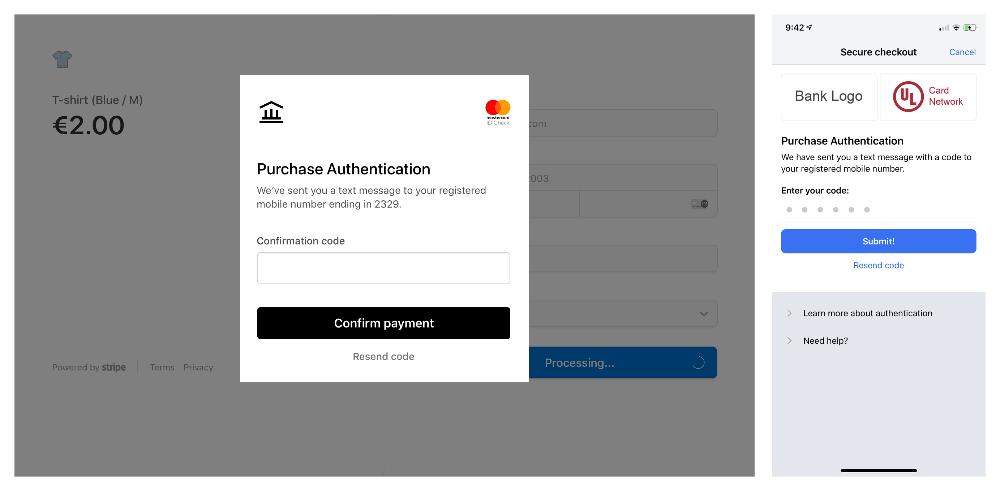
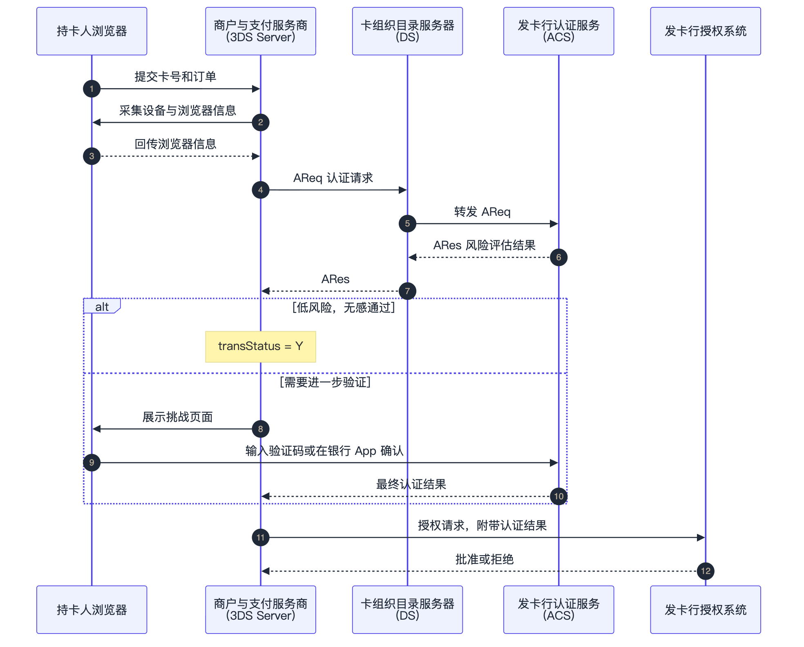
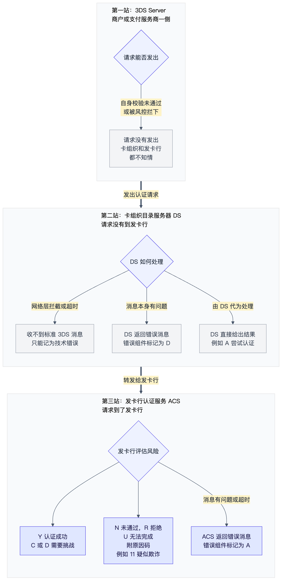
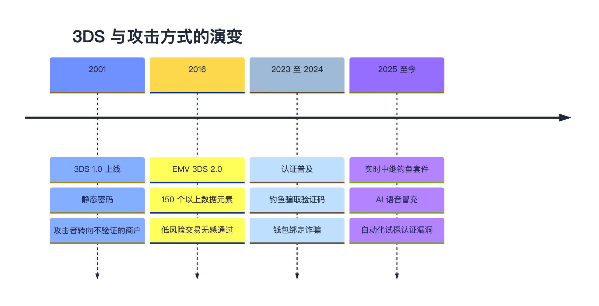
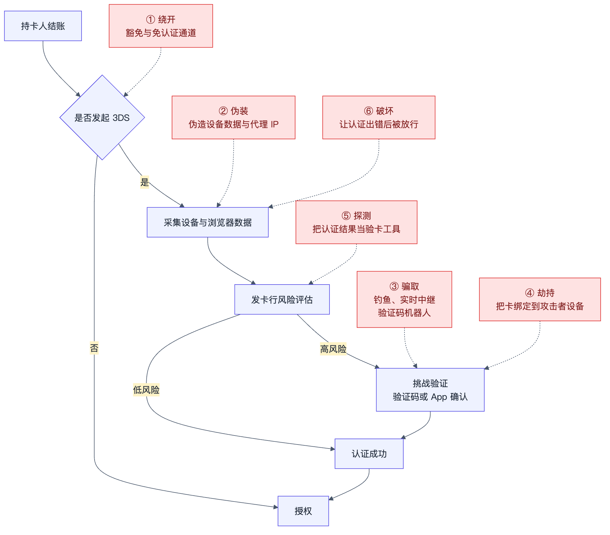
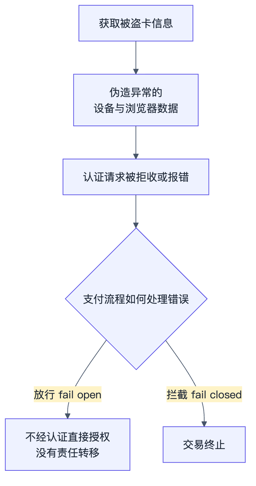
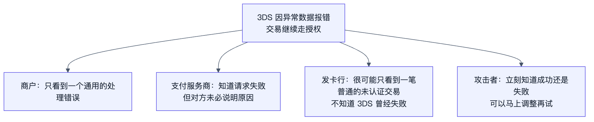
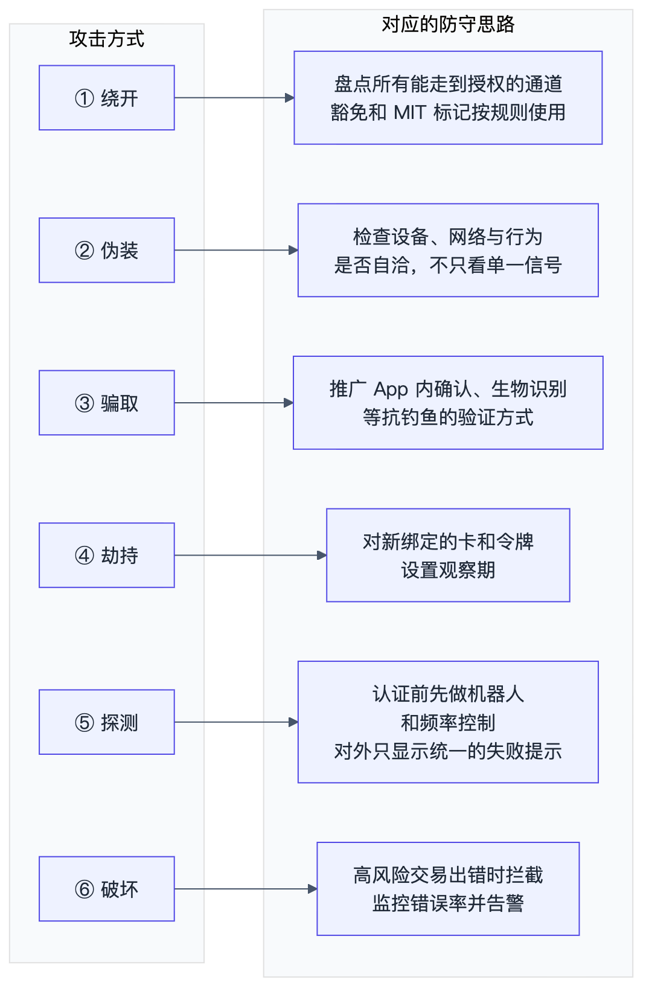

# 第 4 章　3DS 挡住了什么，又漏掉了什么

越来越多的国内团队在做海外业务：游戏、SaaS、AI 应用、跨境电商。只要面向海外用户收款，就绕不开 Visa、Mastercard、American Express 这些国际卡组织的信用卡，也就绕不开 3DS。海外持卡人在网上付款时，常会遇到跳出发卡行页面，输入短信验证码，或者在银行 App 里点一下确认，这就是 3DS。二十多年来，它一直是海外电商支付最重要的防线之一，公开数据也证明它确实有效。

需要先说明范围：本章讨论的是国际卡组织的卡在海外线上支付中的认证机制，不讨论中国大陆境内发行的银行卡在国内的线上支付认证。

但防线越强，攻击者越会研究它的边界。他们不再只是「偷到卡号就去刷」，而是围绕认证流程的每一个环节寻找突破口：有的绕开认证，有的伪装成低风险用户，有的骗走持卡人的验证码，有的干脆把 3DS 当成验卡工具，还有的想办法让认证「出错」。AI 的普及，正在让这些试探变得更便宜、更快、更有规模。

本章想讲清楚五件事：3DS 是怎么工作的；不同海外市场对它有什么要求；它的标准能告诉我们什么，不能告诉我们什么；攻击者目前在用哪几类方法对付它；以及出海团队可以怎么应对。

## 4.1 3DS 是什么

3DS（3-D Secure）是卡组织为线上刷卡设计的持卡人认证协议。第一版在 2001 年上线 [1]，当时的体验是跳转到银行页面输入静态密码，不少商户和发卡行认为它更像是阻碍成交的门槛，而不是防欺诈工具 [2]。

2016 年，由主要卡组织组成的 EMVCo 发布了 EMV 3DS 2.0 [1][3]。新版本最大的变化是数据：商户可以传给发卡行的数据元素，从 3DS 1.0 的约 15 个增加到 150 个以上，包括设备、浏览器、收货地址和历史交易等信息 [2]。发卡行据此判断风险，低风险交易在后台直接通过（frictionless，无感认证），高风险交易才要求持卡人输入验证码或在 App 中确认（challenge，挑战验证）[1][4]。

没有在海外刷过卡的读者，可能没见过挑战验证长什么样。下面是两个示例：在网页上结账时，页面会弹出发卡行的认证窗口，提示验证码已经发到持卡人预留的手机号，输入正确后才能完成付款；在手机 App 里付款，体验类似，只是认证界面直接嵌在 App 里 [5]。实际界面由各家发卡行设计，样式会有差别，有的发卡行也会改成跳转到银行 App 里确认。

图 4.1：挑战验证的界面示例。左为网页结账时弹出的认证窗口，右为手机 App 内的认证界面（示意图，来源：Stripe 文档）

一次典型的浏览器端 3DS 流程如下：

图 4.2：EMV 3DS 浏览器端认证流程（简化）

图中有三个关键角色：

1. 3DS Server：通常由商户或支付服务商运营，负责收集数据，组装认证请求（AReq）。
2. 目录服务器（DS）：由卡组织运营，负责把请求路由到对应的发卡行。
3. 发卡行认证服务（ACS）：在发卡行一侧，负责评估风险，决定是否需要挑战，并返回结果（ARes）。

认证通过后，商户在授权请求中带上认证结果。认证成功的交易通常可以获得责任转移（liability shift），也就是欺诈损失转由发卡行承担 [6]。

这里有一个后面会反复出现的细节：图 4.2 中第 2、3 步采集的浏览器和设备信息，是在持卡人的设备上由前端代码收集的。换句话说，这部分数据本质上是客户端「自报」的，商户的服务器无法从源头保证它的真实性。

## 4.2 出海之前要知道：3DS 的规则因市场而异

是否要求 3DS，各个海外市场差别很大：

1. 欧洲经济区和英国：PSD2 的强客户认证（SCA）要求对线上卡支付做认证，3DS 是最主要的实现方式 [7]。
2. 日本：日本经济产业省公布的「信用卡安全指南」要求，原则上所有电商商户在 2025 年 3 月底前导入 EMV 3DS [8]。
3. 印度、澳大利亚等市场也有可能要求使用 3DS 的相关规定 [7]。
4. 美国：没有强制要求，3DS 是可选的 [7]。而且情况和欧洲不太一样：一份基于美国交易的分析发现，美国发卡行往往把请求 3DS 的交易视为高风险，更倾向于直接拒绝，而不是让用户走一遍不熟悉的验证流程 [9]。

这意味着，同一套风控策略放到不同市场，效果可能完全不同。在不强制 3DS 的市场，交易未必经过认证，风控更依赖商户自己的规则；在强制 3DS 的市场，豁免和例外处理就成了需要重点关注的地方。

还有两点对订阅类业务尤其重要：

1. 订阅续费通常属于商户发起交易（MIT），一般不再走 3DS。以日本为例，绑卡时完成 3DS 后，后续的商户发起扣款不需要再做 3DS [10]。所以，首次绑卡和首次支付，往往是整个订阅生命周期里唯一一次认证机会。如果这一步被突破，后面的每一次续费都会照常进行。
2. 欺诈和验卡流量的代价不只是损失本身。Visa 从 2025 年 6 月起执行新的收单监控计划（VAMP），按月计算商户的欺诈与争议比例，以及被识别为枚举攻击的授权交易比例，超过阈值的商户和收单机构需要采取整改措施 [11]。对出海团队来说，这直接关系到收款通道是否稳定。

## 4.3 3DS 能告诉我们什么，不能告诉我们什么

一次认证请求要依次经过三站：商户或支付服务商一侧的 3DS Server，卡组织的目录服务器（DS），最后才是发卡行的认证服务（ACS）。请求可能停在任何一站，停在哪一站，决定了商户能拿到什么信息。

EMV 3DS 规范定义的返回内容有三类 [6][12]：

1. 交易状态（transStatus）：Y 认证成功，A 尝试认证，N 未通过，U 无法完成，R 拒绝，C 需要挑战，D 解耦认证，I 仅供参考。
2. 状态原因码（transStatusReason）：在 N、U、R 时必须提供，例如 01 认证失败，11 疑似欺诈，22 ACS 技术问题。
3. 错误消息（Erro）：当消息本身有问题时返回，例如 101 消息无效，201 缺少必填字段，203 字段格式无效，402 交易超时。每条错误消息都带有一个「错误组件」字段（errorComponent），标明是哪一方发现了错误：C 是 3DS SDK，S 是 3DS Server，D 是卡组织的 DS，A 是发卡行的 ACS。

需要注意的是，规范写明交易状态和原因码既可以由发卡行的 ACS 填写，也可以由卡组织的 DS 填写，其中 80 到 99 号原因码专门留给 DS 使用 [6]。同一个返回值，不一定来自发卡行。按请求停下的位置，可以分成三种情况：

1. 停在商户或支付服务商一侧。请求在 3DS Server 就没有发出，比如数据校验没有通过，或者被服务商自己的风控拦下。卡组织和发卡行都不知道这次请求的存在。如果是 3DS Server 或 SDK 发现了错误，错误组件会标为 S 或 C。
2. 停在卡组织，没有到发卡行。请求到了 DS，但没有被转发出去。这时可能出现三种结果：消息格式或必填字段有问题，DS 返回错误消息，错误组件标为 D；DS 代为处理并直接给出结果，比如规范允许「尝试认证」由 ACS 或 DS 提供 [12]，这时拿到的 A 并不代表发卡行看过这笔交易；请求在网络层就被安全设施拦下或者超时，商户连一条标准的 3DS 消息都收不到，只能记为技术错误。
3. 到了发卡行。ACS 评估风险之后，返回 Y、N、R、U、C、D 等状态，在 N、U、R 时附上原因码。如果是 ACS 发现消息有问题或处理超时，错误组件标为 A。

图 4.3：一次 3DS 请求可能停在哪一站，以及每一站可能返回什么。灰色表示请求没有到达发卡行，蓝色表示请求到了发卡行

把这三站放在一起看，会发现几个结构性的盲区。

第一，只看交易状态，无法确定发卡行有没有评估过这笔交易。同样是 A 或 U，可能来自发卡行，也可能来自卡组织 [6][12]。

第二，「疑似欺诈」这类风险判断，要等请求真正到达发卡行，并且完成风险评估之后才会出现。请求停在前两站时，商户拿不到发卡行的任何风险意见。

第三，错误消息说明的是「谁发现了问题」和「问题是什么」，而不是「为什么出问题」。错误组件告诉你是 DS 还是 ACS 发现的，错误码告诉你是字段格式不对还是超时。但一个因为前端兼容问题导致格式错误的正常请求，和一个被刻意构造成异常的攻击请求，在错误消息上可能看起来一模一样。

第四，在网络层被拦截或超时的请求，没有任何标准消息可看。商户只能记为一次技术错误，既不知道请求停在了哪里，也不知道原因。

第五，认证成功只说明「这次验证通过了」，并不说明「通过验证的是持卡人本人」。如果验证码被骗走，或者攻击者的设备已经被绑定为验证设备，3DS 会如实返回「成功」。

所以，标准里有成功，有失败，有错误，但没有一个字段专门告诉你「这是一次攻击」。这并不是规范的缺陷，3DS 的设计目标是认证持卡人，而不是识别攻击流量。但它意味着，识别攻击这件事，必须由支付流程中的其他环节来补上。

## 4.4 攻击者如何对付 3DS：从过去到现在

3DS 普及之后确实有效。欧洲银行管理局（EBA）和欧洲央行（ECB）2024 年的联合报告显示，经过强客户认证（SCA）的交易，欺诈率低于未经认证的交易，这一点在卡支付上尤其明显；而当交易对手位于欧洲经济区以外、不一定要求 SCA 时，卡支付的欺诈率大约高出十倍 [13]。

防线变强，攻击者就换路线。EBA 在 2024 年的意见书中总结得很清楚：SCA 成功遏制了基于窃取凭证的欺诈，但欺诈者转向了更复杂的手段，包括操纵付款人，钓鱼结合诱导授权，以及破坏验证设备的绑定流程 [14]。

图 4.4：3DS 与攻击方式的演变

把公开报告里的案例放在一起，可以把目前常见的攻击归纳为六条路径。它们分别作用在 3DS 链条的不同位置：

图 4.5：六类攻击在 3DS 链条上的位置

### ① 绕开：不让 3DS 发生

最直接的办法，是去没有 3DS 的地方。攻击者会把盗来的卡拿到不要求认证的商户或地区使用，或者利用不需要认证的交易类型。EBA 和 ECB 的数据显示，部分 SCA 豁免场景，以及不在 SCA 范围内的交易类型，欺诈率更高 [13]。

豁免本身是合规且必要的设计，比如小额交易豁免、交易风险分析豁免，以及商户发起交易（MIT，例如订阅扣款）。但需要注意，豁免被批准的交易，以及标记为 MIT 的交易，都不享有责任转移 [15]。如果这些通道被滥用，损失由商户承担。

对单个商户来说，最弱的那条通道决定了整体的风险水平。一家支付安全厂商在分析中指出，即使主结账流程有严格认证，只要还有一个旧接口能直接发起授权，或者绑卡流程不做认证，攻击者就会找到那里 [16]。

### ② 伪装：让自己看起来像低风险用户

3DS 2.0 的无感认证依赖发卡行对数据的判断。对手里没有持卡人手机的攻击者来说，一旦触发挑战，往往就意味着失败。所以他们会努力让请求「看起来正常」：伪造常见的浏览器和设备特征，用代理网络隐藏真实来源。

公开分析指出，如果机器人提交了足够逼真的设备数据，又恰好使用一张真实有效的卡，仍然可能在没有挑战的情况下通过认证 [16]。Visa 给商户的建议中，也专门提到要使用具备代理识别能力的设备指纹工具 [17]。

### ③ 骗取：拿到持卡人的验证码

既然验证码只有持卡人能收到，那就骗持卡人。这是近几年最活跃的一条路径。

1. 传统钓鱼：冒充快递通知或银行，引导持卡人在假页面输入卡号和验证码。Visa 在 2025 年的报告中把这类「验证码绕过」诈骗列为重点威胁之一 [18]。
2. 实时中继：网络安全公司 Group-IB 在 2026 年披露了一个名为 Milk Dragon 的「钓鱼即服务」套件。它通过社交平台上的低价商品广告引流，用伪造的电商结账页实时获取受害者输入的内容，再根据受害者的发卡行展示对应的伪造验证页面，把验证码实时转交给操作者完成真实交易。自 2025 年 10 月以来，研究人员发现了 258 个钓鱼页面，受害者分布在 66 个国家 [19]。
3. 页面注入：攻击者在被入侵的正规网站上注入恶意脚本，窃取结账时输入的卡信息。Recorded Future 估计，2025 年活跃的此类网页盗刷脚本超过 10,500 个，可能影响了超过 2,300 万笔线上交易 [20]。
4. 语音冒充：美国联邦调查局（FBI）提醒，犯罪分子会用 AI 生成的语音冒充他人，以获取银行账户的访问权限 [21]。

Recorded Future 的年度报告把这一趋势概括为：截获一次性密码已经成为绕过认证的主流手段，而且常常用来补上其他欺诈链条中的缺口 [20]。值得注意的是，在暗网上出售的被盗卡记录中，附带联系方式的比例上升到了 82% [20]，这让针对持卡人的定向钓鱼更容易实施。

### ④ 劫持：把卡绑到攻击者的设备上

比骗一次验证码更进一步的，是把验证能力整个拿走。

EBA 把这种手法称为「绑定流程攻击」：通过钓鱼、短信或电话诈骗获取持卡人的凭证，再把欺诈者自己的设备注册为认证的第二要素，从而完全接管账户，进行多笔欺诈交易 [14]。

一个典型的变体是手机钱包绑定诈骗。持卡人在钓鱼网站输入卡号后，会被告知「银行需要发送验证码确认这笔小额交易」，但实际上，这个验证码是银行用来确认「把卡添加到手机钱包」的。受害者一旦提供验证码，卡就被加载到了攻击者的手机上 [22]。新加坡银行公会在 2025 年 2 月就此发出公开提醒，并宣布主要发卡行将对手机钱包绑卡要求增加 App 内确认等额外验证 [23]。Visa 还观察到，攻击者越来越倾向于在绑定成功后等待一周以上再开始盗刷，以避开针对新令牌的监控 [18]。

### ⑤ 探测：把 3DS 当作验卡工具

这条路径的目标不是盗刷，而是验卡。攻击者手里有大量来源不明、不知道是否有效的卡号，他们需要一个便宜、快速的方法筛出能用的卡。

公开资料显示，攻击者会用脚本批量提交绑卡或小额支付请求，然后收集 3DS 或发卡行的响应来判断哪些卡有效 [24]。由于认证发生在授权之前，即使最终没有发起扣款，认证结果本身就可能泄露信息。一篇 2026 年发布在 arXiv 上的论文专门分析了这种「3DS 预言机」问题，并引用了 Mastercard 一项专利申请中的描述：欺诈者可以用猜测的卡号发起交易，依靠认证环节返回的信号判断哪些卡号对应真实账户 [25]。

这类活动规模不小。Visa 报告称，疑似枚举攻击的交易在半年内增长了 22% [18]；Recorded Future 估计，2025 年基于 Telegram 的验卡服务至少验证了 2,700 万条卡记录 [20]。

### ⑥ 破坏：让认证「出错」

最后一条路径更隐蔽：不去绕开 3DS，也不去骗持卡人，而是想办法让 3DS 自己出错。

它利用的是支付流程中一个很常见的设计选择：当 3DS 因为技术原因无法完成时，流程该怎么办？一份公开的 EMV 3DS 规范参考，对「无法完成」状态给出的处理建议是：可以重试，或者在没有责任转移的情况下继续授权 [6]。一些支付流程为了避免因偶发技术故障损失正常订单，会选择继续授权。这种设计通常被称为 fail open（出错时放行），与之相对的是 fail closed（出错时拦截）。

图 4.6：让认证出错的攻击逻辑

攻击者如果发现，某种异常的设备或浏览器数据会让认证请求被拒收或报错，而出错之后支付流程又会放行，那么他们就得到了一条「不经认证直接授权」的通道。这种攻击之所以难以察觉，是因为每个参与方看到的都只是一小块拼图：

图 4.7：认证出错后，各方看到的信息

商户看到的是一个通用的处理错误，很容易被当成技术问题。发卡行在授权时，很可能只看到一笔普通的未认证电商交易。真正掌握完整信息的，反而是攻击者：每一次请求的成败，他们都能立刻知道，然后调整参数再试。

### 六条路径的共同点

回头看这六条路径，它们其实都在利用4.3 节提到的那个盲区：3DS 告诉你认证的结果，却不告诉你结果背后发生了什么。认证成功，可能是持卡人本人，也可能是拿到验证码的攻击者；认证失败或出错，可能是系统故障，也可能是有人在试探。

## 4.5 AI 如何改变攻防节奏

为什么这些路径在现在更值得警惕？一个重要的背景是，AI 正在降低攻击者每一步的成本。

在「骗取」这条路径上，AI 让钓鱼内容和冒充变得更逼真、更容易本地化。FBI 在 2024 年 12 月的公告中警告，犯罪分子正在利用生成式 AI 以更大的规模实施欺诈，减少了他们所需投入的时间和精力，其中包括用 AI 生成的语音冒充他人 [21]。

在「探测」和「破坏」这两条路径上，AI 让大规模试错变得更容易。Anthropic 披露，2025 年 9 月，一个网络间谍组织利用其 AI 编程工具搭建了自动化攻击框架。在人类只负责少数关键决策的情况下，AI 完成了约 80% 至 90% 的战术操作，包括侦察、发现并验证漏洞、编写利用代码；在峰值时，请求频率常常达到每秒多次 [26][27]。

在整个欺诈产业层面，Visa 在 2026 年春季的威胁报告中写道，攻击者使用 AI 规模化地自动执行工作流程，并快速迭代和调整手法 [28]。Visa 在 2025 年秋季也指出，欺诈已经从机会主义犯罪演变为系统化、工业化的运作，犯罪分子在搭建可以跨攻击类型复用的基础设施 [29]。Recorded Future 则观察到，攻击者正在积极地把 AI 融入欺诈攻击链，同时提醒，AI 代理代替用户购物的「代理式商务」，会把用户意图和代理意图变成一个新的攻击面 [20]。

把这些放在一起，我们的看法是：支付流程中的豁免规则、错误处理和回退逻辑，正是自动化工具最擅长探索的地方。过去，要找到「哪条通道不做认证」「哪种数据能让认证出错」「出错后系统会不会放行」，需要攻击者有经验、有耐心，一点点手工尝试。现在，这种大规模、低成本的试错可以交给自动化程序，甚至交给 AI 代理去完成。同时，像 Milk Dragon 这样的「钓鱼即服务」套件，把原本需要专业技术的实时中继打包成了可以订阅的产品 [19]。

## 4.6 出海团队可以做什么

面对这六条路径，没有一个单点措施可以全部解决。比较实际的做法，是针对每一条路径补上对应的那块拼图：

图 4.8：六类攻击与对应的防守思路

1. 针对「绕开」：盘点所有能走到授权的通道，包括旧接口、绑卡流程和各种跳过认证的条件。豁免和 MIT 标记按卡组织规则使用，不把普通交易随意标记为免认证 [15][16]。
2. 针对「伪装」：不要只依赖单一信号。设备、网络、行为之间是否自洽，往往比任何一个字段都更能说明问题 [17]。
3. 针对「骗取」：在发卡行一侧，逐步用 App 内确认、生物识别等更难被钓鱼的方式替代短信验证码 [23]。在商户一侧，保护好结账页面，防止恶意脚本注入。
4. 针对「劫持」：对新绑定的设备、新加入手机钱包的卡设置观察期。EBA 建议，新设备在申请后应间隔一段时间再生效，并及时向已绑定的设备发送提醒 [14]；Visa 也建议发卡行把令牌的「年龄」纳入风控 [18]。
5. 针对「探测」：在发起认证之前先做机器人识别和频率控制，对外只显示统一的失败提示，把详细的原因码留在内部日志里 [16]。Visa 也建议监控 3DS 交易中的卡段突增等异常 [30]。
6. 针对「破坏」：不要对所有认证错误一律放行。对低风险的熟客，出错时放行可以减少误伤；但对高风险交易，或者设备与浏览器数据明显异常的交易，更稳妥的做法是拦截，或者要求重新验证。同时监控「无法完成」和各类错误的比例，与自身历史水平以及同类商户对比，突然升高时把它当作风险信号来排查。

除了这六点，出海团队还有三件事值得单独做：

1. 按市场分别看数据。同一条风控规则，在强制 3DS 的欧洲、日本，和不强制的美国，效果可能完全不同。认证率、拒付率、争议率最好按卡的发行国家拆开看，而不是只看全局平均。
2. 订阅业务把首次绑卡当作关口。续费一般不再认证，所以绑卡和首次支付这一步的风控要比单次购买更严。对已经绑上、但当时风险信号明显的卡，要有回溯排查和处理的机制。
3. 关注卡组织的监控指标。按月跟踪欺诈与争议比例，以及验卡类攻击的规模，不要等到收单机构通知时才发现超标 [11]。

最后，和支付服务商保持沟通。很多细节只有支付服务商能看到，比如请求在哪个环节失败，失败前后的数据有什么特征。商户发现异常时，尽早提供样本交易，有助于更快定位。

也可以定期问自己一个问题：如果有人故意让我的每一道检查都失效，或者都出错，我的系统最后会放行还是拦截？

## 4.7 小结

3DS 让线上支付安全了很多，这一点有公开数据支持。但任何防线都有边界，而 AI 正在让攻击者更快地找到这些边界。

过去我们关心的是「认证有没有通过」；现在还需要关心「是谁通过了认证」「认证为什么没有完成」，以及「没有完成的时候，我们做了什么」。在支付安全里，例外路径同样是主路径的一部分。

## 本章参考资料

1. Stripe，3D Secure 2 指南：https://stripe.com/guides/3d-secure-2
2. Broadcom，EMV 3-D Secure: Enhanced Data Driving Better Customer Experiences：https://docs.broadcom.com/doc/emv-3-d-secure-enhanced-data-driving-better-customer-experiences
3. Wikipedia，3-D Secure：https://en.wikipedia.org/wiki/3-D_Secure
4. Visa，3D Secure: your guide to safer transactions：https://corporate.visa.com/en/solutions/visa-protect/insights/3d-secure.html
5. Stripe，Authenticate with 3D Secure：https://docs.stripe.com/payments/3d-secure/authentication-flow
6. EMV 3DS Specification Full Reference（v2.3.1.1）：https://3dsspec.com/exports/3ds-spec-full.md
7. Stripe，3D Secure authentication：https://docs.stripe.com/payments/3d-secure
8. 日本经济产业省，「クレジットカード・セキュリティガイドライン」が改訂されました（2024 年 3 月）：https://www.meti.go.jp/press/2023/03/20240315002/20240315002.html
9. Stripe，Surprising findings from our analysis of 3DS transactions in the US：https://stripe.com/blog/surprising-findings-from-our-analysis-of-3ds-transactions-in-the-us
10. Stripe，Japan 3DS mandate exemptions：https://docs.stripe.com/payments/3d-secure/japan-exemptions
11. Visa，Visa Acquirer Monitoring Program Fact Sheet 2025：https://corporate.visa.com/content/dam/VCOM/corporate/visa-perspectives/security-and-trust/documents/visa-acquirer-monitoring-program-fact-sheet-2025.pdf
12. 3DSecure.io，Specification 2.2.0：https://docs.3dsecure.io/3dsv2/specification_220.html
13. EBA 与 ECB，2024 Report on Payment Fraud：https://www.eba.europa.eu/sites/default/files/2024-08/465e3044-4773-4e9d-8ca8-b1cd031295fc/EBA_ECB%202024%20Report%20on%20Payment%20Fraud.pdf
14. EBA，Opinion on new types of payment fraud and possible mitigations（2024 年 4 月）：https://eba.europa.eu/sites/default/files/2024-04/363649ff-27b4-4210-95a6-0a87c9e21272/Opinion%20on%20new%20types%20of%20payment%20fraud%20and%20possible%20mitigations.pdf
15. Stripe，Strong Customer Authentication exemptions：https://docs.stripe.com/payments/3d-secure/strong-customer-authentication-exemptions
16. GPayments，3D Secure 在卡片测试攻击中的作用与局限（Where 3D Secure Helps Against Card Testing）：https://www.gpayments.com/blog/article/3ds-card-testing-attacks/
17. Visa，Anti-Enumeration and Account Testing Best Practices: Considerations for Merchants：https://usa.visa.com/content/dam/VCOM/global/support-legal/documents/anti-enumeration-and-account-testing-best-practices-merchant.pdf
18. Visa PERC，Biannual Threats Report（Spring 2025）：https://corporate.visa.com/content/dam/VCOM/corporate/solutions/documents/visa-perc-biannual-report-spring-2025.pdf
19. Group-IB，Milk Dragon: Huge Discounts on Social Media? Think Twice Before You Buy（2026 年 10 月）：https://www.group-ib.com/blog/milk-dragon/
20. Recorded Future，Annual Payment Fraud Intelligence Report 2025：https://assets.recordedfuture.com/Reports/Annual_Payment_Fraud_Intelligence_Report_2025.pdf
21. FBI IC3，Criminals Use Generative Artificial Intelligence to Facilitate Financial Fraud（I-120324-PSA）：https://www.ic3.gov/PSA/2024/PSA241203
22. Krebs on Security，How Phished Data Turns into Apple & Google Wallets（2025 年 2 月）：https://krebsonsecurity.com/2025/02/how-phished-data-turns-into-apple-google-wallets/
23. 新加坡银行公会（ABS），Major card issuing banks to step up measures to combat card provisioning scams（2025 年 2 月）：https://www.abs.org.sg/docs/library/major-card-issuing-banks-to-step-up-measures-to-combat-card-provisioning-scams.pdf
24. Stripe，Protect yourself from card testing：https://docs.stripe.com/disputes/prevention/card-testing
25. arXiv，The 3DS Oracle: BIN Attack via the Network：https://arxiv.org/html/2610.32206
26. Anthropic，Disrupting an AI-orchestrated cyber espionage campaign：https://www.anthropic.com/news/disrupting-AI-espionage
27. Anthropic，Full report: Disrupting the first reported AI-orchestrated cyber espionage campaign：https://www-cdn.anthropic.com/d7dd50dd1185f59be051b307150d877f2b82bd2c.pdf
28. Visa，Spring 2026 Biannual Threats Report：https://corporate.visa.com/content/dam/VCOM/corporate/visa-perspectives/newsroom/documents/visa-spring-biannual-threats-report-2026.pdf
29. Visa，Ahead of Holiday Season, Visa Identifies Five Transformative Forces Reshaping Global Payment Security：https://visa.gcs-web.com/news-releases/news-release-details/ahead-holiday-season-visa-identifies-five-transformative-forces
30. Visa，Guidance to Guard Against Enumeration Attacks and Account Testing Schemes：https://usa.visa.com/content/dam/VCOM/global/support-legal/documents/visa-guidance-to-guard-against-enumeration-sept.pdf
